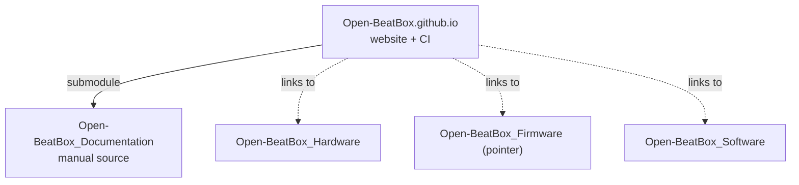

# Open-BEATBox

**Open** — **BE**havioural and **A**u**T**onomous operant **Box** — is an open-source, modular, low-cost platform for autonomous home-cage operant conditioning and long-duration behavioural data acquisition in rodents.

Mice interact with behavioural tasks inside their home cage over long periods, which reduces repeated handling while increasing within-subject data density. Everything needed to build, run and extend a system is published here: mechanical design, electronics, firmware, control software and documentation.

🌐 **[open-beatbox.github.io](https://open-beatbox.github.io/)** · 📖 **[Technical manual](https://open-beatbox.github.io/docs/manual/)** · 🎬 **[Video tutorials](https://www.youtube.com/@open-beatbox/)**

---

## Where to start

| I want to… | Go to |
| --- | --- |
| Understand what the system does | [Project website](https://open-beatbox.github.io/) |
| Build one | [Assembly tutorials](https://open-beatbox.github.io/docs/manual/build/assembly-tutorials/tutorials_index.html) |
| Follow an interactive bench guide | [Interactive assembly guide](https://open-beatbox.github.io/docs/beatbox-assembly-tutorial.html) |
| Read the full technical reference | [Technical manual](https://open-beatbox.github.io/docs/manual/) |
| Order parts | [Master bill of materials](https://open-beatbox.github.io/docs/manual/build/bom.html) |
| Watch the build | [YouTube channel](https://www.youtube.com/@open-beatbox/) |

---

## Repositories

Each layer lives in its own repository under the open licence that suits it.

| Repository | Contents | Licence |
| --- | --- | --- |
| **[Open-BeatBox_Hardware](https://github.com/Open-BeatBox/Open-BeatBox_Hardware)** | CAD, enclosure, PCB and mechanical design files (V2 and V3), with print- and laser-ready exports | CERN-OHL-S-2.0 |
| **[Open-BeatBox_Firmware](https://github.com/Open-BeatBox/Open-BeatBox_Firmware)** | Placeholder for stand-alone firmware releases; the module firmware lives in `Open-BeatBox_Software/micropython` | GPL-3.0 |
| **[Open-BeatBox_Software](https://github.com/Open-BeatBox/Open-BeatBox_Software)** | PC application (Qt), data acquisition and experiment control, module firmware (MicroPython) | AGPL-3.0-or-later |
| **[Open-BeatBox_Documentation](https://github.com/Open-BeatBox/Open-BeatBox_Documentation)** | Source of the technical manual, the module assembly guides and the master BOM (`source/build/assembly-tutorials`), technical notes and media | CC-BY-4.0 |
| **[Open-BeatBox.github.io](https://github.com/Open-BeatBox/Open-BeatBox.github.io)** | The public website and its build pipeline | AGPL-3.0 |

### How they fit together

The website builds the manual at deploy time by pulling the documentation in as a submodule. The engineering repositories stand alone.

Clone the website with `git clone --recurse-submodules`, or the documentation alone if you only want the manual.

---

## The system

A BEATBox is an instrumented home cage built from independent modules, so a lab can build only the parts a protocol needs.

| Module | Role |
| --- | --- |
| Frame and enclosure | Laser-cut and 3D-printed structure that carries the modules |
| Feeder | Motorised pellet delivery with IR verification |
| Photobeam gate | Infrared passage detection between compartments |
| Screen | Two displays; responses detected by infrared light curtains (no touch input) |
| Light ring | Controlled illumination and visual cueing |
| Water bottle mount | Fixed bottle position and guide |

Typical uses: autonomous operant conditioning, reward-delivery and sensor-triggered tasks, longitudinal home-cage monitoring, and circadian or motivational dynamics.

---

## Citing Open-BEATBox

If you use Open-BEATBox in published work, please cite **both** the reference preprint and the Zenodo record of the release you used:

> Euvrard M, Benzina N, Domingues D, Mondragón-González SL, Huzard D, Penderia G, Travert-Jouanneau Y, Lavielle O, Lousada E, Schreiweis C, Lorenz A, Pavlov P, Ajili Z, Lebegue L, Tissier P, Burguière E. "Open-BEATBox: an open-source autonomous operant chamber for high-throughput data acquisition of complex behaviour." bioRxiv, 2026 (DOI to be added when the preprint is posted).

Each release of the Hardware, Software and Documentation repositories is archived on Zenodo with its own DOI (release `biorxiv-v1` for the version in the preprint; DOI: to be added once release `biorxiv-v1` is published on Zenodo). The firmware is part of the Software record. Every repository has a `CITATION.cff` file for GitHub's *Cite this repository* button.

## Licensing

Open-BEATBox uses layer-specific open licences, so each part carries terms appropriate to its medium:

- **Hardware** — CERN-OHL-S-2.0 (strongly reciprocal open hardware)
- **Firmware** — GPL-3.0
- **Software and website** — AGPL-3.0
- **Documentation** — CC-BY-4.0

Each repository's own `LICENSE` file is authoritative for that layer.

---

## Contributing

Contributions are welcome. File issues and pull requests in the repository that owns the material:

- Assembly steps, BOM entries and supplier references → [Open-BeatBox_Documentation](https://github.com/Open-BeatBox/Open-BeatBox_Documentation) (`source/build/assembly-tutorials`)
- Manual pages, protocols and technical notes → [Open-BeatBox_Documentation](https://github.com/Open-BeatBox/Open-BeatBox_Documentation)
- CAD, PCB and mechanical design → [Open-BeatBox_Hardware](https://github.com/Open-BeatBox/Open-BeatBox_Hardware)
- Firmware → [Open-BeatBox_Software](https://github.com/Open-BeatBox/Open-BeatBox_Software) (`micropython/`)
- GUI, acquisition and analysis → [Open-BeatBox_Software](https://github.com/Open-BeatBox/Open-BeatBox_Software)
- Website and documentation build → [Open-BeatBox.github.io](https://github.com/Open-BeatBox/Open-BeatBox.github.io)

Validation reports, troubleshooting notes and reproducible data-output examples from other labs are particularly useful.

---

## Contact

Developed at the **Centre de Recherche en Neurosciences de Lyon (CRNL)**, CH Le Vinatier, Bron, France.

📧 [eric.burguiere@cnrs.fr](mailto:eric.burguiere@cnrs.fr)
